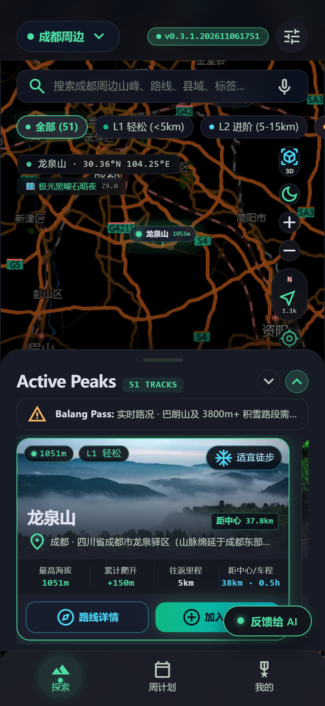
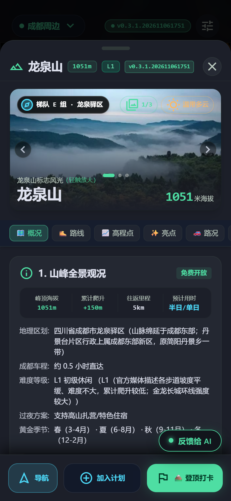
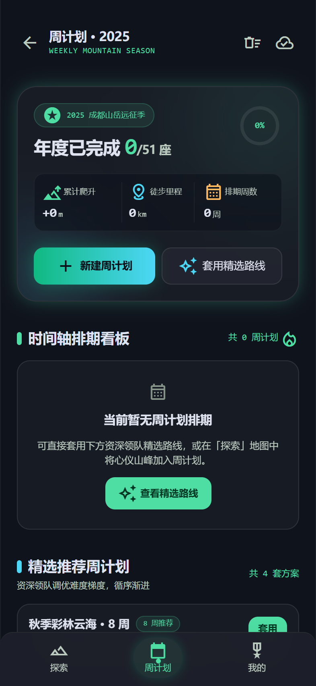
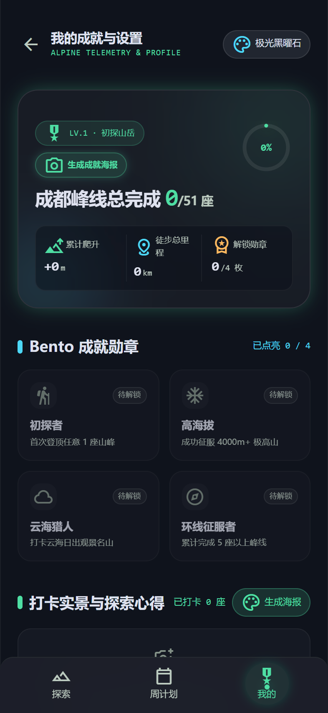

> [!IMPORTANT]
> **【法律免责与性质声明 (Legal Disclaimer & Explicit Nature)】**
> 1. **明确性质**：本仓库及项目纯属个人业余登山路线记录与互联网公开地理数据整理，**绝非专业安全指南，亦不构成对任何户外路线安全性、可行性的保证或推荐**。高山与自然户外环境存在滑坠、落石、涉水、失温、高原反应、迷路及气象突变等不可预知的固有客观危险。使用者应具备完全民事行为能力，出行前务必向当地属地主管部门及景区管理机构核实最新开放状态与管制通告，全面评估自身体能、健康与装备储备，自主决策、自甘风险并自行承担全部责任。
> 2. **历史版本与时效性特别声明**：本仓库所有历史版本（Releases / Tags）仅作为软件工程开发过程的存档记录，受自然地理环境变迁、气象灾害与管制政策动态调整影响，**历史版本中包含的路线数据与描述严重滞后，绝对不反映当前的风险认知，严禁作为出行依据**；当前版本已包含更新的风险说明与安全警示，请始终以最新主分支版本为准。本项目不维持任何旧版路线的时效性背书。
> 3. **使用即同意与自甘风险兜底**：凡访问、浏览、下载、克隆或使用本软件及本仓库数据，即表示您已充分阅读、完全理解并自愿接受上述全部声明，自愿依据《民法典》第一千一百七十六条自甘风险原则自行承担线下出行及数据使用的一切潜在风险与法律责任。如您不同意上述任何条款，请立即停止使用并退出/删除本仓库与数据。

<div align="center">

# 🏔️ 每周一山 · 成都周边 50 座山
### *Weekly Mountain · Alpine Explorer*

**专为成都及川西户外登山、徒步探索爱好者打造的个人高山拓扑记录与开源离线数据看板**

[](https://vuejs.org/)
[](https://vitejs.dev/)
[](https://capacitorjs.com/)
[](https://tailwindcss.com/)
[](LICENSE)
[](releases/)
[](https://github.com/lylyuanliang/weekly-mountain/releases)

<p align="center">
  <a href="#-核心特性">核心特性</a> •
  <a href="#-界面精选预览">界面预览</a> •
  <a href="#-山峰索引与覆盖范围">山峰索引</a> •
  <a href="#-本地运行与开发指南">本地开发</a> •
  <a href="#-线上部署与发布方案">部署指南</a> •
  <a href="#-开源协议与免责声明">开源协议</a>
</p>

</div>

---

## 📖 产品简介

《每周一山 · 成都周边 50 座山》（Alpine Explorer）打破了传统户外攻略零散、图层迟钝与信息过时的痛点。项目基于 **暗黑高山拓扑设计系统（Stitch Dark Alpine Architecture）** 构建，将 51 座成都周边及川西名山的地理测绘、路线轨迹、实景影像、行车导航、气象遥测与打卡成就深度融合，提供 0ms 极速响应、原生级触控手感及离线可用的户外探索体验。

无论你是刚开始接触近郊轻户外（L1～L2 低爬升路线），还是进行高海拔体能拉练（L3～L5 进阶重装），都能在指尖便捷检索客观地理数据。

---

## 📸 界面精选预览

<div align="center">

| **01. 探索主页与拓扑地图** | **02. 12 大指标详情抽屉** |
| :---: | :---: |
|  |  |
| *交互式暗黑高山地图 · 多维度标签即时筛选* | *实景画廊 · 路况驾驶 · 两步路/导航一键调起* |

| **03. 周末周计划规划器** | **04. Bento 遥测成就与设置** |
| :---: | :---: |
|  |  |
| *本周目标 · 装备清单核验 · 倒计时看板* | *峰线完成率 · 勋章体系 · 一键生成成就长图* |

</div>

---

## ✨ 核心特性

### 1. 🏔️ 51 座名山全景深度数据库
- **12 大硬核指标**：标高、累计爬升、往返里程、徒步耗时、自驾车程、难度梯队（L1-L5）、最佳季节、过夜露营条件、费用门票、路况驾驶风险、无信号路段预警及推荐起点 GPS 坐标。
- **川西大环线多区域架构**：内置「成都周边」（51 座）与「川西进阶环线」两套区域，支持平滑一键切换。

### 2. 🗺️ 两步路 / 六只脚 户外轨迹 Deep Link 深度联动
- 详情抽屉集成**户外助手深度唤起引擎**，点击任一推荐 GPX 轨迹搜索词，自动清洗纯净关键词、写入系统剪贴板，并通过 URL Scheme 唤醒手机上的 **两步路 App** 或 **六只脚 App**；未安装时平滑降级至网页检索。

### 3. 🚗 原生地图一键直达导航
- 一键唤起手机已安装的原生导航软件（**高德地图**、**百度地图**、**腾讯地图**、**Apple 地图**），自动传递山峰精确 GPS 坐标与推荐登山起点名称，直达路线规划；同时支持免装 App 的高德网页版平滑回退。

### 4. 🖼️ 153+ 张高清摄影实景画廊
- 收录川西与成都周边名山实景摄影，内置沉浸式全屏画廊弹窗（Lightbox），支持双向滑动手势、方向键快速切换与**挖孔屏/灵动岛响应式安全区垫高**。

### 5. 📅 周末周计划规划器 (Trip Planner)
- 支持新建周目标排期，集成团队同伴人数设定、徒步装备清单打勾核验、天气适宜度预警与出发倒计时看板。

### 6. 🎖️ Bento 遥测成就与长图海报分享
- 实时统计累计爬升高度、登顶峰线总数与照片打卡日志；
- 内置初探者、高海拔、云海猎人、环线征服者等 Bento 勋章；
- 支持基于 `html2canvas` **一键生成高质感暗黑高山成就长图海报**，一键保存至手机相册分享至朋友圈或户外社群。

### 7. 🎨 三大视觉主题自由切换
- **极光黑曜石 (Aurora Obsidian)**：深邃黑底与极光绿微光，专注高山探索质感；
- **水墨江南 (Ink Landscape)**：内敛典雅的东方水墨灰调；
- **旷野露营 (Wild Camping)**：大地色系与森林旷野绿意。

### 8. 📱 跨端运行与纯净发布架构
- **现代 Web / PWA**：自适应桌面端与移动端浏览器；
- **Android 原生容器**：基于 Capacitor 8 原生打包，具备原生状态栏适配与极速原生渲染；
- **构建变体隔离**：支持开发者联调版（Debug）与外部体验内测版（Release）一键分流构建。

---

## ⛰️ 山峰索引与覆盖范围

本项目精选并核验了 51 座具有代表性的名山峰线，按地形景观与难度层级划分：

```
成都周边每周一山
├── ☁️ A组 · 云海日出 (龙泉山、牛背山、达瓦更扎、四姑娘山大峰、轿子顶等)
├── ❄️ B组 · 雪山远眺 (巴朗山、赵公山、蓥华山、光光山、狮子王峰等)
├── 🌲 C组 · 森林瀑布 (青城后山、九峰山、天台山、鸡冠山、龙池等)
├── 🍁 D组 · 红叶彩林 (米亚罗、毕棚沟、孟屯河谷、玛嘉沟等)
└── ⛩️ E组 · 古道人文 (青城前山、峨眉山、鹤鸣山、大坪村等)
```

---

## 🛠️ 本地运行与开发指南

### 环境要求
- **Node.js**：`>= 18.0`（推荐 Node 20 LTS 或 Node 24）
- **包管理器**：`npm` / `pnpm`
- **Android 编译环境**（若需原生打包）：JDK 17 LTS + Android SDK (API 34+)

### 1. 克隆代码与依赖安装
```bash
git clone https://github.com/lylyuanliang/weekly-mountain.git
cd weekly-mountain
npm install
```

### 2. 环境变量配置
```bash
# 复制示例环境变量文件
cp .env.example .env.local

# 在 .env.local 中填入可选的私有穿透域名（选填，已被 .gitignore 忽略）
# VITE_TUNNEL_URL=https://your-tunnel-domain.cpolar.top
```

### 3. 本地启动开发服务器
```bash
npm run dev
# 浏览器访问 http://localhost:5173
```

### 4. 前端生产打包
```bash
# 默认打包
npm run build

# 纯净版打包（剥离一切调试与反馈代码）
npm run build:release
```

### 5. 自动化 Android APK 打包流水线 (PowerShell)
```powershell
# 编译并归档纯净体验版 Release APK
pwsh -File scripts/build_app.ps1 -Variant release -NoPause

# 编译并归档开发调试版 Debug APK
pwsh -File scripts/build_app.ps1 -Variant debug -NoPause
```

### 6. 真机联调与开发机 AI 哨兵配对秘钥指南 (Debug APK)

本项目 Debug APK 内置了真机智能哨兵（`@lylyuanliang/agent-feedback`）与开发机直连通道。为防止内网穿透（如 cpolar / ngrok）暴露至公网时被未经授权的外部恶意访问，系统启用了 **SHA-256 零明文泄露端侧授权门禁**：

#### 🔑 秘钥生成与查看位置
1. **自动生成**：当首次运行 `npm run dev` 或 `npm run build` 时，系统会自动生成强随机配对秘钥并保存在本地未跟踪文件：
   ```text
   scratch/.agent-feedback-secret
   ```
   *(该文件已被 `.gitignore` 自动忽略，绝不入库，保证开发机凭据安全)*；
2. **自定义配置**：开发者亦可在 `.env.local` 或环境变量中声明自定义秘钥：
   ```env
   AGENT_FEEDBACK_SECRET=wm-your-custom-secret
   ```
3. **安全哈希下发**：构建期仅计算秘钥的 SHA-256 哈希值下发至客户端运行时，即使反编译 APK 也无法直接获取原始明文秘钥。

#### 📱 手机端 Debug APK 配对解锁步骤
1. 打开 Debug 版 App 右上角反馈浮窗，切换至 **「📦 本地包」** 选项卡；
2. 在「开发机内测配对秘钥」输入框中填入上述 `scratch/.agent-feedback-secret` 文件中的秘钥，点击 **「立即配对解锁」**；
3. 解锁后，点击「当前穿透基地址」旁的 **「编辑」** 按钮，填入开发机的局域网 IP（如 `http://192.168.x.x:5173`）或内网穿透域名（如 `https://xxxx.cpolar.top`），点击 **「保存并应用」**；
4. 配对成功后，App 即可直连开发机获取秒级构建的增量 APK 并直接在真机上闭环触发 AI 智能排查修复！也可随时切换至 **「⚙️ 联调设置」** 选项卡查看或重新配置授权状态。

---

## 🌐 线上部署与发布方案

本项目支持全静态化无服务器（Serverless）云端免费托管，涵盖：
- **Cloudflare Pages**（全球 Anycast CDN，国内访问极佳，推荐）
- **GitHub Pages**（Git 提交自动工作流）
- **Gitee Pages**（国内节点托管）
- **Vercel / Netlify**（拖拽秒级发布）

👉 详细完整的配置教程、域名解析与合规指南请参阅独立文档：
**[📖 查看《每周一山》无服务器部署与发布指南 (docs/DEPLOYMENT.md)](docs/DEPLOYMENT.md)**

---

## 📜 开源协议与免责声明

### 开源许可证 (License)
本项目源码采用 **[MIT License](LICENSE)** 协议开源。你可以自由使用、修改、分发与衍生本项目，但须在所有副本中保留原始版权声明与许可条款。

### 攻略数据与内容授权声明
1. **数据版权**：攻略内的山峰基础地理事实信息、实景照片归原整理者所有，仅供户外运动爱好者个人学习、交流与出行参考，严禁未经授权用于商业营销或付费牟利；
2. **底图版权**：地图数据源自 [OpenStreetMap](https://www.openstreetmap.org/)（遵循 ODbL 协议），气象遥测对接 [Open-Meteo](https://open-meteo.com/)（CC-BY 4.0 免费非商业许可）；
3. **安全免责、性质与旧版声明**：本仓库与应用纯属个人业余路线记录及公开地理数据整理，**绝非专业安全指南，亦不构成对任何户外路线安全性、可行性的保证或推荐**。高山徒步与户外穿越具有客观不可控的自然环境风险（包括但不限于高原反应、天气突变、滑坠、落石、涉水、野生动物与失温迷路等）。本项目提供之里程、耗时、爬升、路况、航迹与危险点仅供个人信息检索与经验参考，不可作为生命安全与通行可行性的依据。**历史版本仅为技术开发存档记录，不反映当前风险认知，严禁作为出行参考。**使用者应具备完全民事行为能力，出行前请务必向属地官方部门核实最新管制通告、评估个人健康状况与携带完备应急装备，自主决策并自行承担户外活动的一切安全与民事责任。**凡访问、浏览、下载、克隆或使用本软件及本仓库内容，即表示您已阅读、理解并同意以上全部声明，自愿自行承担一切潜在风险与法律责任；如您不同意上述任何条款，请立即停止使用并退出。**

---

<div align="center">

**山不见我，我自去见山。愿每一次登顶，皆见壮阔天地。**<br>
*Made with ❤️ for Alpine Explorers in Chengdu & Western Sichuan.*

</div>
