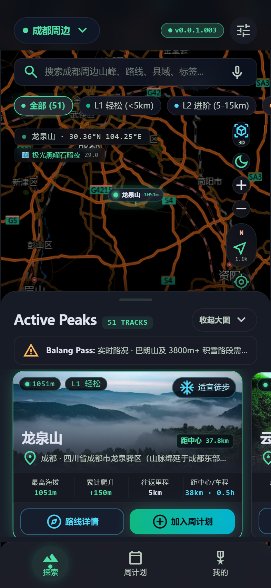
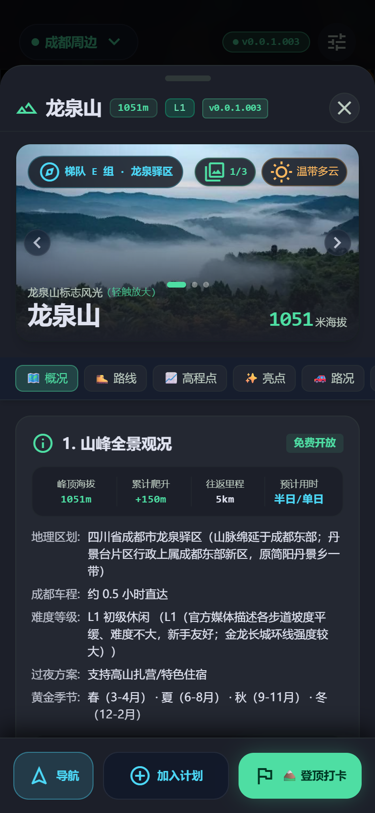
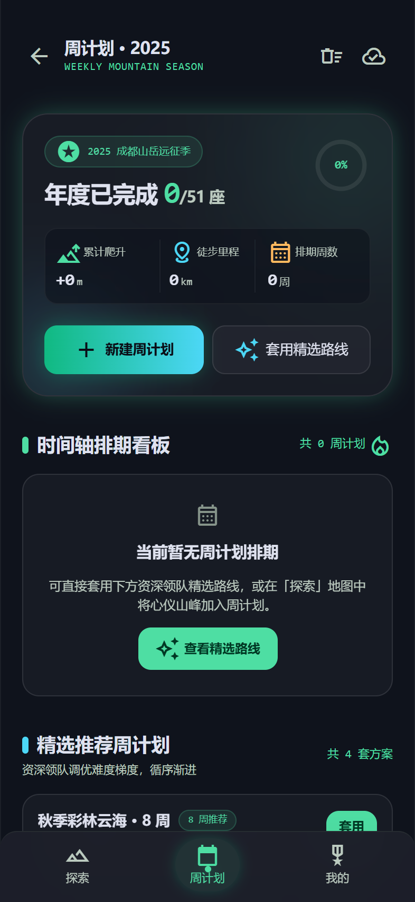
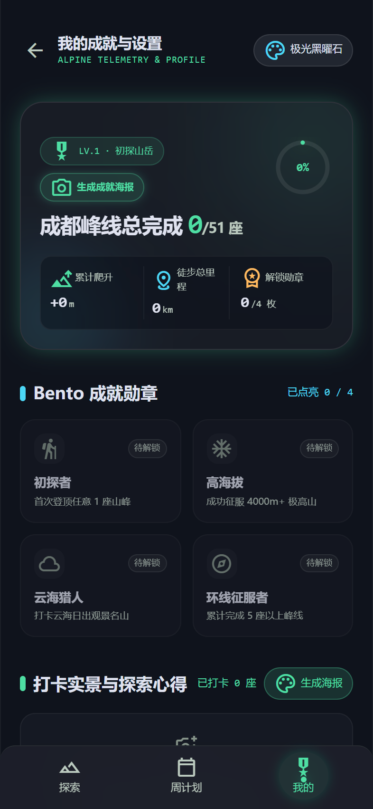

<div align="center">

# 🏔️ 每周一山 · 成都周边 50 座山
### *Weekly Mountain · Alpine Explorer*

**专为成都及川西户外登山、徒步探索爱好者量身打造的一站式现代化移动端高山拓扑手册 & 智能路线规划器**

[](https://vuejs.org/)
[](https://vitejs.dev/)
[](https://capacitorjs.com/)
[](https://tailwindcss.com/)
[](LICENSE)
[]()
[]()

<p align="center">
  <a href="#-核心特性">核心特性</a> •
  <a href="#-界面精选预览">界面预览</a> •
  <a href="#-山峰索引与覆盖范围">山峰索引</a> •
  <a href="#-本地运行与开发指南">本地开发</a> •
  <a href="#-线上部署与发布方案">部署指南</a> •
  <a href="#-开源协议与免责声明">开源协议</a>
</p>

</div>

---

## 📖 产品简介

《每周一山 · 成都周边 50 座山》（Alpine Explorer）打破了传统户外攻略零散、图层迟钝与信息过时的痛点。项目基于 **暗黑高山拓扑设计系统（Stitch Dark Alpine Architecture）** 构建，将 51 座成都周边及川西名山的地理测绘、路线轨迹、实景影像、行车导航、气象遥测与打卡成就深度融合，提供 0ms 极速响应、原生级触控手感及离线可用的户外探索体验。

无论你是刚入坑的初级周末徒步者（L1~L2 轻松休闲），还是追求极高山雪线挑战的硬核驴友（L3~L5 进阶重装），都能在指尖快速锁定下一座山峰。

---

## 📸 界面精选预览

<div align="center">

| **01. 探索主页与拓扑地图** | **02. 12 大指标详情抽屉** |
| :---: | :---: |
|  |  |
| *交互式暗黑高山地图 · 多维度标签即时筛选* | *实景画廊 · 路况驾驶 · 两步路/导航一键调起* |

| **03. 周末周计划规划器** | **04. Bento 遥测成就与设置** |
| :---: | :---: |
|  |  |
| *本周目标 · 装备清单核验 · 倒计时看板* | *峰线完成率 · 勋章体系 · 一键生成成就长图* |

</div>

---

## ✨ 核心特性

### 1. 🏔️ 51 座名山全景深度数据库
- **12 大硬核指标**：标高、累计爬升、往返里程、徒步耗时、自驾车程、难度梯队（L1-L5）、最佳季节、过夜露营条件、费用门票、路况驾驶风险、无信号路段预警及推荐起点 GPS 坐标。
- **川西大环线多区域架构**：内置「成都周边」（51 座）与「川西进阶环线」两套区域，支持平滑一键切换。

### 2. 🗺️ 两步路 / 六只脚 户外轨迹 Deep Link 深度联动
- 详情抽屉集成**户外助手深度唤起引擎**，点击任一推荐 GPX 轨迹搜索词，自动清洗纯净关键词、写入系统剪贴板，并通过 URL Scheme 唤醒手机上的 **两步路 App** 或 **六只脚 App**；未安装时平滑降级至网页检索。

### 3. 🚗 原生地图一键直达导航
- 一键唤起手机已安装的原生导航软件（**高德地图**、**百度地图**、**腾讯地图**、**Apple 地图**），自动传递山峰精确 GPS 坐标与推荐登山起点名称，直达路线规划；同时支持免装 App 的高德网页版平滑回退。

### 4. 🖼️ 153+ 张高清摄影实景画廊
- 收录川西与成都周边名山实景摄影，内置沉浸式全屏画廊弹窗（Lightbox），支持双向滑动手势、方向键快速切换与**挖孔屏/灵动岛响应式安全区垫高**。

### 5. 📅 周末周计划规划器 (Trip Planner)
- 支持新建周目标排期，集成团队同伴人数设定、徒步装备清单打勾核验、天气适宜度预警与出发倒计时看板。

### 6. 🎖️ Bento 遥测成就与长图海报分享
- 实时统计累计爬升高度、登顶峰线总数与照片打卡日志；
- 内置初探者、高海拔、云海猎人、环线征服者等 Bento 勋章；
- 支持基于 `html2canvas` **一键生成高质感暗黑高山成就长图海报**，一键保存至手机相册分享至朋友圈或户外社群。

### 7. 🎨 三大视觉主题自由切换
- **极光黑曜石 (Aurora Obsidian)**：深邃黑底与极光绿微光，专注高山探索质感；
- **水墨江南 (Ink Landscape)**：内敛典雅的东方水墨灰调；
- **旷野露营 (Wild Camping)**：大地色系与森林旷野绿意。

### 8. 📱 跨端运行与纯净发布架构
- **现代 Web / PWA**：自适应桌面端与移动端浏览器；
- **Android 原生容器**：基于 Capacitor 8 原生打包，具备原生状态栏适配与极速原生渲染；
- **构建变体隔离**：支持开发者联调版（Debug）与外部体验内测版（Release）一键分流构建。

---

## ⛰️ 山峰索引与覆盖范围

本项目精选并核验了 51 座具有代表性的名山峰线，按地形景观与难度层级划分：

```
成都周边每周一山
├── ☁️ A组 · 云海日出 (龙泉山、牛背山、达瓦更扎、四姑娘山大峰、轿子顶等)
├── ❄️ B组 · 雪山远眺 (巴朗山、赵公山、蓥华山、光光山、狮子王峰等)
├── 🌲 C组 · 森林瀑布 (青城后山、九峰山、天台山、鸡冠山、龙池等)
├── 🍁 D组 · 红叶彩林 (米亚罗、毕棚沟、孟屯河谷、玛嘉沟等)
└── ⛩️ E组 · 古道人文 (青城前山、峨眉山、鹤鸣山、大坪村等)
```

---

## 🛠️ 本地运行与开发指南

### 环境要求
- **Node.js**：`>= 18.0`（推荐 Node 20 LTS 或 Node 24）
- **包管理器**：`npm` / `pnpm`
- **Android 编译环境**（若需原生打包）：JDK 17 LTS + Android SDK (API 34+)

### 1. 克隆代码与依赖安装
```bash
git clone https://github.com/lylyuanliang/weekly-mountain.git
cd weekly-mountain
npm install
```

### 2. 环境变量配置
```bash
# 复制示例环境变量文件
cp .env.example .env.local

# 在 .env.local 中填入可选的私有穿透域名（选填，已被 .gitignore 忽略）
# VITE_TUNNEL_URL=https://your-tunnel-domain.cpolar.top
```

### 3. 本地启动开发服务器
```bash
npm run dev
# 浏览器访问 http://localhost:5173
```

### 4. 前端生产打包
```bash
# 默认打包
npm run build

# 纯净版打包（剥离一切调试与反馈代码）
npm run build:release
```

### 5. 自动化 Android APK 打包流水线 (PowerShell)
```powershell
# 编译并归档纯净体验版 Release APK
pwsh -File scripts/build_app.ps1 -Variant release -NoPause

# 编译并归档开发调试版 Debug APK
pwsh -File scripts/build_app.ps1 -Variant debug -NoPause
```

---

## 🌐 线上部署与发布方案

本项目支持全静态化无服务器（Serverless）云端免费托管，涵盖：
- **Cloudflare Pages**（全球 Anycast CDN，国内访问极佳，推荐）
- **GitHub Pages**（Git 提交自动工作流）
- **Gitee Pages**（国内节点托管）
- **Vercel / Netlify**（拖拽秒级发布）

👉 详细完整的配置教程、域名解析与合规指南请参阅独立文档：
**[📖 查看《每周一山》无服务器部署与发布指南 (docs/DEPLOYMENT.md)](docs/DEPLOYMENT.md)**

---

## 📜 开源协议与免责声明

### 开源许可证 (License)
本项目源码采用 **[MIT License](LICENSE)** 协议开源。你可以自由使用、修改、分发与衍生本项目，但须在所有副本中保留原始版权声明与许可条款。

### 攻略数据与内容授权声明
1. **数据版权**：攻略内的山峰基础地理事实信息、实景照片归原整理者所有，仅供户外运动爱好者个人学习、交流与出行参考，严禁未经授权用于商业营销或付费牟利；
2. **底图版权**：地图数据源自 [OpenStreetMap](https://www.openstreetmap.org/)（遵循 ODbL 协议），气象遥测对接 [Open-Meteo](https://open-meteo.com/)（CC-BY 4.0 免费非商业许可）；
3. **安全免责声明**：高山徒步与户外穿越具有客观不可控的自然环境风险（包括但不限于高原反应、天气突变、滑坠、野生动物与失温迷路等）。本项目提供之里程、耗时、爬升及路况仅作参考，使用者应具备完全民事行为能力，出行前请务必核实属地官方最新管制通告、评估个人健康状况与携带完备应急装备，自行承担户外活动的一切安全责任。

---

<div align="center">

**山不见我，我自去见山。愿每一次登顶，皆见壮阔天地。**<br>
*Made with ❤️ for Alpine Explorers in Chengdu & Western Sichuan.*

</div>
